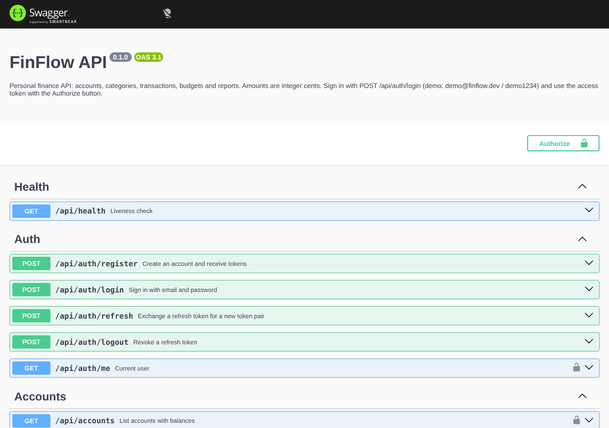
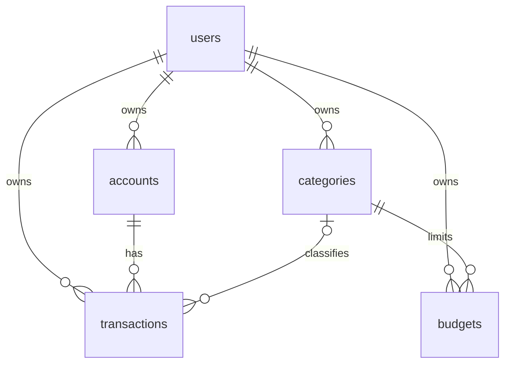
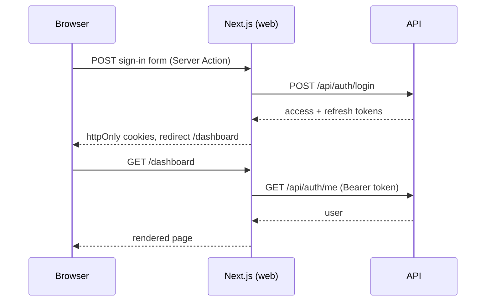
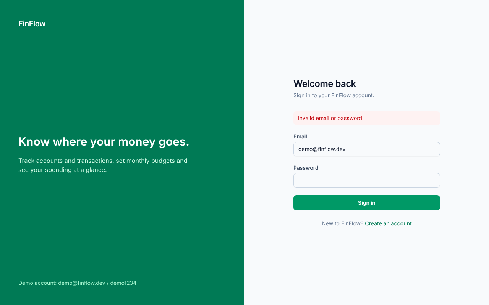

# FinFlow

> 🇧🇷 Resumo em português no [final deste arquivo](#resumo-em-português).

**Personal finance manager.** Track accounts, income and expenses, set monthly budgets per category
and see where your money goes — from a REST API, a web dashboard and a mobile app that share the
same validation rules.

> 🚧 Work in progress — see the [roadmap](./ROADMAP.md).

## Planned architecture

```text
finflow/
├── apps/
│   ├── api/       # NestJS REST API with Drizzle ORM and PostgreSQL
│   ├── web/       # Next.js dashboard
│   └── mobile/    # Expo (React Native) app
└── packages/
    └── shared/    # Zod schemas and helpers shared by every app
```

| Part    | Technologies                                          |
| ------- | ----------------------------------------------------- |
| API     | Node.js, NestJS, Drizzle ORM, PostgreSQL, JWT         |
| Web     | Next.js, React, TypeScript, Tailwind CSS              |
| Mobile  | Expo, React Native, TypeScript                        |
| Shared  | Zod validation schemas, money helpers                 |
| Tooling | pnpm workspaces, TypeScript, ESLint, Prettier, Vitest |

Money is always stored as **integer cents** to avoid floating-point rounding errors.

## Getting started

Requirements: Node.js 22+ and pnpm 10+.

```bash
pnpm install
pnpm test        # run every package's tests
pnpm lint        # lint every package
pnpm typecheck   # type-check every package
```

### API

Requires a PostgreSQL database (set `DATABASE_URL` in `apps/api/.env`).

```bash
cp apps/api/.env.example apps/api/.env
pnpm --filter @finflow/api build
pnpm --filter @finflow/api db:seed   # apply migrations and create the demo user
pnpm --filter @finflow/api dev       # http://localhost:3333/api/health
```

The demo user is `demo@finflow.dev` / `demo1234`, with three accounts, three months of
transactions and budgets for the current month. Database integration tests run when
`TEST_DATABASE_URL` points to a server where a throwaway database can be created:

```bash
TEST_DATABASE_URL=postgres://postgres@localhost:5432/postgres pnpm --filter @finflow/api test:e2e
```

### Testing

- **Unit tests** (`pnpm --filter @finflow/api test`, `pnpm --filter @finflow/shared test`): pure
  functions, validation schemas, the auth guard, the validation pipe and other helpers.
- **End-to-end tests** (`pnpm --filter @finflow/api test:e2e`): the real NestJS app over HTTP
  against a throwaway PostgreSQL database per test file, covering auth flows, business rules,
  reports and isolation between users.
- **Coverage** (`pnpm --filter @finflow/api test:coverage`): v8 coverage of the end-to-end suite,
  enforced at 90% of statements, functions and lines and 80% of branches.

### API documentation

With the API running, interactive Swagger UI is available at <http://localhost:3333/api/docs>
and the OpenAPI 3.1 document at <http://localhost:3333/api/docs-json>. Request bodies and query
parameters are generated from the same Zod schemas that validate requests, so the docs can't
drift from the actual validation rules.



### Authentication

| Method | Path                 | Description                                             |
| ------ | -------------------- | ------------------------------------------------------- |
| `POST` | `/api/auth/register` | Create an account and receive a token pair              |
| `POST` | `/api/auth/login`    | Sign in with email and password                         |
| `POST` | `/api/auth/refresh`  | Exchange a refresh token for a new pair (rotation)      |
| `POST` | `/api/auth/logout`   | Revoke a refresh token                                  |
| `GET`  | `/api/auth/me`       | Current user (requires `Authorization: Bearer <token>`) |

Access tokens are short-lived JWTs (15 minutes by default). Refresh tokens are random opaque
values stored only as SHA-256 hashes; each can be used once, and replaying a used one revokes
all of the user's sessions. Passwords are hashed with bcrypt. Every route requires an access
token unless it is explicitly marked as public.

### Accounts

| Method   | Path                | Description                                                           |
| -------- | ------------------- | --------------------------------------------------------------------- |
| `GET`    | `/api/accounts`     | List accounts with their current balance (`?includeArchived=true`)    |
| `POST`   | `/api/accounts`     | Create an account (`name`, `type`, `currency`, `initialBalanceCents`) |
| `GET`    | `/api/accounts/:id` | Get one account                                                       |
| `PATCH`  | `/api/accounts/:id` | Rename, change type or initial balance, archive/unarchive             |
| `DELETE` | `/api/accounts/:id` | Delete an account without transactions (others are archived)          |

Balances are computed in the database from the initial balance and the account's transactions.
Every query is scoped to the authenticated user; other users' resources answer `404`.

### Categories

| Method   | Path                  | Description                                         |
| -------- | --------------------- | --------------------------------------------------- |
| `GET`    | `/api/categories`     | List categories (`?kind=income` or `?kind=expense`) |
| `POST`   | `/api/categories`     | Create a category (`name`, `kind`, `color`)         |
| `GET`    | `/api/categories/:id` | Get one category                                    |
| `PATCH`  | `/api/categories/:id` | Rename or recolor (the kind is fixed)               |
| `DELETE` | `/api/categories/:id` | Delete; its transactions become uncategorized       |

New users start with a default set of income and expense categories.

### Transactions

| Method   | Path                    | Description                         |
| -------- | ----------------------- | ----------------------------------- |
| `GET`    | `/api/transactions`     | Paginated, filtered and sorted list |
| `POST`   | `/api/transactions`     | Record an income or expense         |
| `GET`    | `/api/transactions/:id` | Get one transaction                 |
| `PATCH`  | `/api/transactions/:id` | Update any field                    |
| `DELETE` | `/api/transactions/:id` | Delete a transaction                |

List query parameters: `page`, `pageSize` (max 100), `from` and `to` (`YYYY-MM-DD`),
`accountId`, `categoryId`, `kind`, `search` (description, case-insensitive) and `sort`
(`date_desc`, `date_asc`, `amount_desc`, `amount_asc`). Responses include `total` and
`totalPages`. A transaction's category must match its kind, and archived accounts can't receive
new transactions.

### Budgets

| Method   | Path                  | Description                                                                       |
| -------- | --------------------- | --------------------------------------------------------------------------------- |
| `GET`    | `/api/budgets`        | Budgets of `?month=YYYY-MM` (default: current) with spending                      |
| `GET`    | `/api/budgets/alerts` | Budgets at 80% or more of their limit, worst first                                |
| `POST`   | `/api/budgets`        | Set a monthly limit for an expense category (`categoryId`, `month`, `limitCents`) |
| `PATCH`  | `/api/budgets/:id`    | Change the limit                                                                  |
| `DELETE` | `/api/budgets/:id`    | Remove a budget                                                                   |

Each budget reports `spentCents`, `remainingCents`, `usage` (e.g. `0.85`) and a `status` of `ok`,
`warning` (80% or more) or `exceeded` (over 100%), computed from the month's expenses in one query.

### Reports

| Method | Path                                                | Description                                                  |
| ------ | --------------------------------------------------- | ------------------------------------------------------------ |
| `GET`  | `/api/reports/monthly-summary?month=YYYY-MM`        | Income, expenses, net, savings rate and the previous month   |
| `GET`  | `/api/reports/spending-by-category?from=&to=`       | Expenses per category with share of the total, largest first |
| `GET`  | `/api/reports/monthly-trend?months=6&until=YYYY-MM` | Income, expenses and net per month, without gaps             |

All aggregation happens in PostgreSQL (`SUM ... FILTER`, `GROUP BY`), so reports stay fast as data
grows and never load individual transactions into the API.

### Data model



Schema changes are made in `apps/api/src/database/schema.ts`; `pnpm --filter @finflow/api
db:generate` writes a new SQL migration to `apps/api/drizzle/`. Constraints live in the database
too: positive amounts, one budget per category and month, case-insensitive unique emails.

## Web app

`apps/web` is a Next.js 16 (App Router) client styled with Tailwind CSS. It talks to the API from
the server only, as a small backend-for-frontend:

- **Sign-in and sign-up** are Server Actions. They validate with the same zod schemas as the API
  (`@finflow/shared`), so field errors match on both sides.
- **Tokens never reach the browser's JavaScript.** The access and refresh tokens are stored in
  `httpOnly`, `SameSite=Lax` cookies (`Secure` in production).
- **Silent refresh:** when the access token is missing or rejected, the page redirects to
  `/api/session/refresh`, which rotates the token pair and sends the user back where they were.
- **Route protection** lives in `src/proxy.ts`: signed-out users are sent to `/login` and
  signed-in users skip the auth pages.



```bash
cp apps/web/.env.example apps/web/.env.local   # FINFLOW_API_URL=http://localhost:3333/api
pnpm --filter @finflow/web dev                  # http://localhost:3000
```



## License

[MIT](./LICENSE) © Nicolas Cardenas

---

## Resumo em português

**FinFlow** é um gerenciador de finanças pessoais: contas, receitas e despesas, orçamentos mensais
por categoria e relatórios de gastos. O projeto é um monorepo com uma API REST (NestJS + Drizzle +
PostgreSQL), um painel web (Next.js) e um aplicativo mobile (Expo), que compartilham as mesmas regras
de validação. Valores monetários são sempre guardados em centavos inteiros. Está em
desenvolvimento; o progresso está no [roadmap](./ROADMAP.md).
