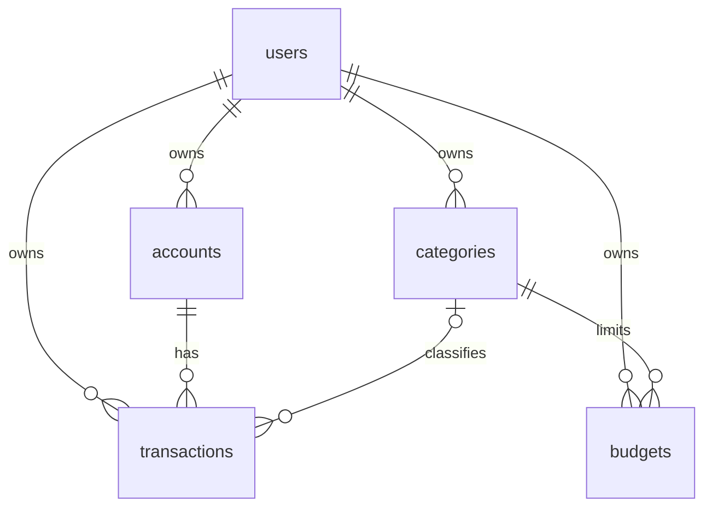

# FinFlow

> 🇧🇷 Resumo em português no [final deste arquivo](#resumo-em-português).

**Personal finance manager.** Track accounts, income and expenses, set monthly budgets per category
and see where your money goes — from a REST API, a web dashboard and a mobile app that share the
same validation rules.

> 🚧 Work in progress — see the [roadmap](./ROADMAP.md).

## Planned architecture

```text
finflow/
├── apps/
│   ├── api/       # NestJS REST API with Drizzle ORM and PostgreSQL
│   ├── web/       # Next.js dashboard
│   └── mobile/    # Expo (React Native) app
└── packages/
    └── shared/    # Zod schemas and helpers shared by every app
```

| Part    | Technologies                                          |
| ------- | ----------------------------------------------------- |
| API     | Node.js, NestJS, Drizzle ORM, PostgreSQL, JWT         |
| Web     | Next.js, React, TypeScript, Tailwind CSS              |
| Mobile  | Expo, React Native, TypeScript                        |
| Shared  | Zod validation schemas, money helpers                 |
| Tooling | pnpm workspaces, TypeScript, ESLint, Prettier, Vitest |

Money is always stored as **integer cents** to avoid floating-point rounding errors.

## Getting started

Requirements: Node.js 22+ and pnpm 10+.

```bash
pnpm install
pnpm test        # run every package's tests
pnpm lint        # lint every package
pnpm typecheck   # type-check every package
```

### API

Requires a PostgreSQL database (set `DATABASE_URL` in `apps/api/.env`).

```bash
cp apps/api/.env.example apps/api/.env
pnpm --filter @finflow/api build
pnpm --filter @finflow/api db:seed   # apply migrations and create the demo user
pnpm --filter @finflow/api dev       # http://localhost:3333/api/health
```

The demo user is `demo@finflow.dev` / `demo1234`, with three accounts, three months of
transactions and budgets for the current month. Database integration tests run when
`TEST_DATABASE_URL` points to a server where a throwaway database can be created:

```bash
TEST_DATABASE_URL=postgres://postgres@localhost:5432/postgres pnpm --filter @finflow/api test:e2e
```

### Data model



Schema changes are made in `apps/api/src/database/schema.ts`; `pnpm --filter @finflow/api
db:generate` writes a new SQL migration to `apps/api/drizzle/`. Constraints live in the database
too: positive amounts, one budget per category and month, case-insensitive unique emails.

## License

[MIT](./LICENSE) © Nicolas Cardenas

---

## Resumo em português

**FinFlow** é um gerenciador de finanças pessoais: contas, receitas e despesas, orçamentos mensais
por categoria e relatórios de gastos. O projeto é um monorepo com uma API REST (NestJS + Drizzle +
PostgreSQL), um painel web (Next.js) e um aplicativo mobile (Expo), que compartilham as mesmas regras
de validação. Valores monetários são sempre guardados em centavos inteiros. Está em
desenvolvimento; o progresso está no [roadmap](./ROADMAP.md).
